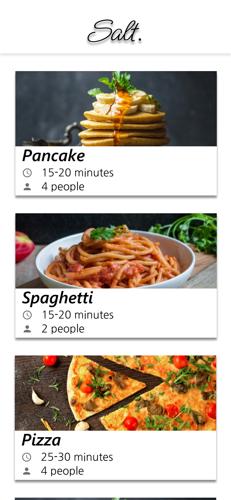
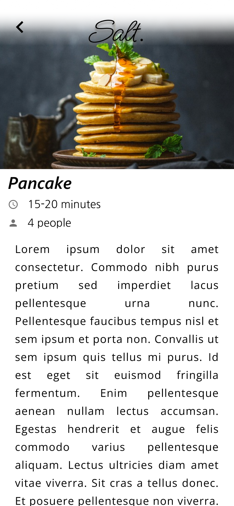
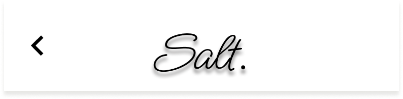

# Salt: Recipe App UI Design

Salt is a mobile recipe app UI design created in Figma. It covers the main flow of the app: a splash screen, a recipe overview list, and a recipe detail page.

**Interactive prototype:** [View in Figma](https://www.figma.com/proto/RK3TFVaHVTHPMeI05aRthu/Recipe-App?node-id=3-4&p=f&t=31csMPDjFW3GynfE-1&scaling=scale-down&content-scaling=fixed&page-id=0%3A1&starting-point-node-id=1%3A7)

## Screens

### Splash Screen

### Overview
A list of recipes the user can browse.

### Detail

## Components

Reusable components used across the screens:

| Header | List item |
|--------|-----------|
|  |  |

## Tools

- Figma

## Notes

- **Goal:** I designed Salt to be [simple / clean / easy to use] for people who want to [find recipes quickly / cook at home / plan meals].
- **Design choices:** I used [colour or palette] and the [font name] typeface to give the app a [warm / fresh / modern] feel.
- **Layout:** The overview screen uses a [list / card] layout so users can [scan recipes quickly].
- **What I learned:** This was my first project on GitHub, and I practised [components, auto layout, prototyping, exporting designs].

## Author

**Dhruvi Bodalia**
- UI/UX designer
- GitHub: [@Dhruvi313](https://github.com/Dhruvi313)
- LinkedIn: [Dhruvi Bodalia](https://www.linkedin.com/in/dhruvi0301)
